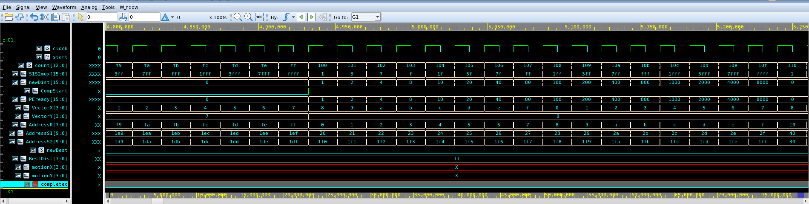
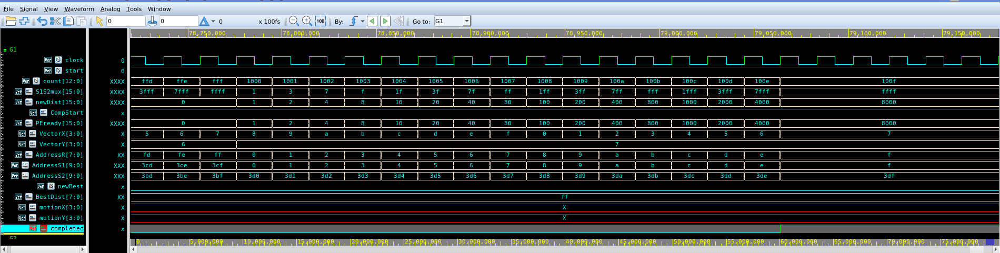
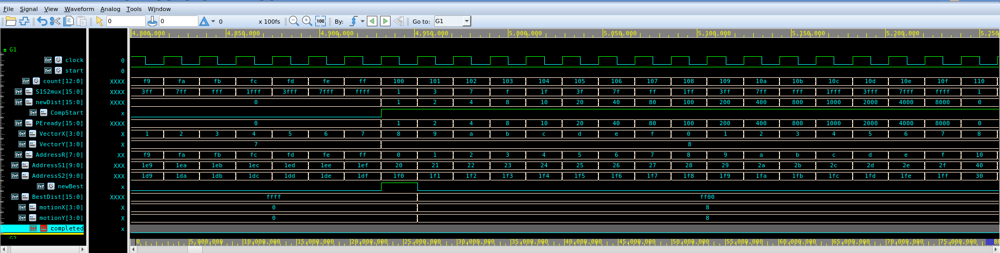
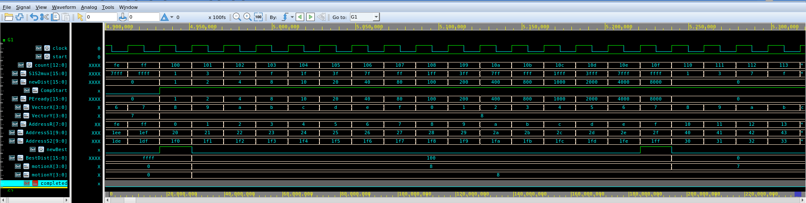
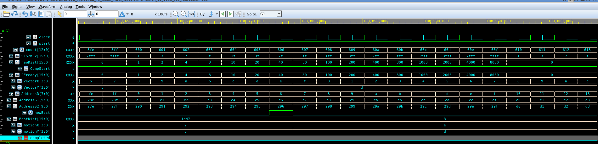
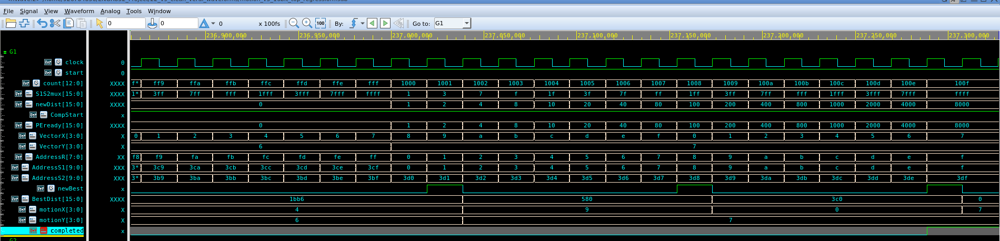
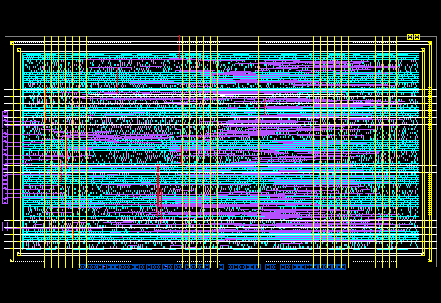

# Motion Estimator Native Verdi Studio (`v1.0` → `v8.3`) — Full-Stack ASIC Web IDE & Verification Platform (`:8789`)

[](REVISION_HISTORY_AND_CHANGELOG.md)
[](docs/lifecycle_v8_3/FINAL_NATIVE_VERDI_ACCEPTANCE_REPORT.md)
[_SAED14_FinFET-blue)](#520-mhz-14nm-finfet-asic--native-verdi-architecture)
[-059669)](evidence/v9_signoff/icv/top.LAYOUT_ERRORS)
[](evidence/v9_signoff/pt_signoff/SLOW_global_timing.rpt)
[](#1-command-quick-start-localhost8789)
[](AI_AGENT_CONTEXT_INDEX.json)

The complete source code, multi-agent backend, real-time Native Synopsys Verdi X11 bridge, open-source Verilog sandbox (`iverilog` + `vvp` + `Yosys`), SQLite multi-tenant web platform (`http://127.0.0.1:8789/`), full revision history (`v1.0` → `v8.3`), preserved verification logs, and raw/captured waveforms supporting the **520 MHz 14nm FinFET Full-Search Block-Matching Motion Estimator ASIC** ([`huynguyen1017/motion-estimator-asic-lab-notebook-2026`](https://github.com/huynguyen1017/motion-estimator-asic-lab-notebook-2026)).

> **For Recruiters, Engineering Managers & External AI Agents**: Start with [`llms.txt`](llms.txt) or [`AI_AGENT_CONTEXT_INDEX.json`](AI_AGENT_CONTEXT_INDEX.json) for a machine-readable map of every Python backend module, REST/SSE endpoint, ASIC RTL/testbench target, waveform capture, and acceptance test report.

---

## Featured Showcase: Evolution from `v1.0` Console → `v8.3` Native Synopsys Verdi & Multi-Agent Studio


Across 10+ major software iterations, this platform grew from a 100-page course manual tracker (`v1.0`) into a hardened, zero-dependency Python + SQLite engineering platform (`v8.3`) that bridges a live browser IDE directly to **Synopsys Verdi `nWave`** over XQuartz/SSH, alongside a sandboxed local **Icarus Verilog + Yosys** waveform studio:

- **`v1.0` → `v2.0`**: 100-Page Section-5 one-liner box, Three-Method RTL Study Guide (`F0–F17`, `L1–L11`, `HW1–HW4`), Terminal Window Doctor, and 200-Q/300-Q quiz bank.
- **`v3.0` → `v5.2`**: Full-stack dark IDE → 5-tab Rose & Lavender Studio with live macOS Terminal mirroring, XQuartz launcher, 600+ 3D flashcards, Midterm `Q1–Q15`, quote-safe shell sanitizer (`split_shell_commands_quote_safe`), and self-healing AI auto-debugger.
- **`v6.0`**: **100 / 100 manual pages (`page001..page100`) executed and verified** with `ARCHIVE_MANIFEST_SHA256.json` logs and PNG captures.
- **`v7.0` → `v7.1`**: `OrchestratorPlatform` (7 core agent classes), `13/13` fault-injection tests, authenticated Native Synopsys Verdi X11 bridge (`engr852_native_verdi_bridge.py`), Defect-D Tcl wrapper, privacy-redacted captures, and `25/25` `T01–T25` acceptance suite.
- **`v8.0` → `v8.1`**: Public **JUNIOR DEVELOPER** SQLite multi-tenant platform (`junior_developer_v8_core.py`), guest-to-student migration, Junior Connect Q&A, real-time Messenger, macOS Seatbelt `iverilog`/`vvp`/`Yosys` sandbox (`$system` blocked), and `15/15` `AC01–AC15` security tests.
- **`v8.2` (`MASTER-RECOVERY-v8.2`)**: Fixed P0 `<nWave:4>` 3-signal Tcl `[12:0]` command-substitution crash (`DEF-V82-01..03`), added durable async `POST /api/v1/native-jobs` (`202 Accepted` in `<50 ms`), 10-agent orchestration status (`/api/v8/agents/status`), bounded `NetworkHealthAgent` circuit breaker (`CLOSED/HALF_OPEN/OPEN`), and `LaunchAgent` supervision (`7/7` V8.2 checks PASS + `17/17` live signals verified).
- **`v8.3` (`Lifecycle Hardening`)**: Eliminated `"Remember to save signals..."` modal blocks (`wvSaveSignal` + X11 `WM_DELETE_WINDOW`), added 20-state Verdi lifecycle machine, monotonic `selection_generation_id`, 10-step orderly cleanup (`0` broad `pkill`), 6 self-healing lifecycle agents, and **`18/18` NV + `51/51` Regression Matrix + `100/100` multi-figure transition stability loop PASS**.

See [`REVISION_HISTORY_AND_CHANGELOG.md`](REVISION_HISTORY_AND_CHANGELOG.md) for commit hashes, modified modules, and defect resolution details across every version.

---

## 1-Command Quick-Start (`localhost:8789`)

`practice_from_scratch/web_console/server.py` runs purely on the **Python 3 Standard Library** (`http.server`, `sqlite3`, `ctypes`, `threading`, `subprocess`, `pty`) — zero third-party `pip` packages needed:

```bash
git clone https://github.com/huynguyen1017/motion-estimator-native-verdi-studio-2026.git
cd motion-estimator-native-verdi-studio-2026
ENGR852_CONSOLE_PORT=8789 python3 practice_from_scratch/web_console/server.py
# Open http://127.0.0.1:8789/ in your browser
```

For local macOS service management and healthchecks, see [`practice_from_scratch/scripts/manage_staging_8789.sh`](practice_from_scratch/scripts/manage_staging_8789.sh). Notice that [`practice_from_scratch/state_store/junior_developer_v8.sqlite3`](practice_from_scratch/state_store/junior_developer_v8.sqlite3) is included with seeded courses and demo accounts while `sessions` has been emptied (`0` active tokens) via `DELETE FROM sessions; VACUUM;` for public safety.

---

## Live Synopsys Verdi `nWave`, Surfer & 14nm Layout Waveform Evidence

All **46 `.vcd` waveform dumps** (`motion_v5_16bit_top_regression.vcd` `25.85 MB`, `motion_verification_520mhz.vcd` `17.07 MB`, plus 44 sandbox `simulation.vcd` captures), **45 screenshots**, and **38 per-job `verdi_window_redacted.png` captures** are cataloged in [`WAVEFORM_AND_TEST_LOG_CATALOG.md`](WAVEFORM_AND_TEST_LOG_CATALOG.md).

| Figure ID | Description | Live / Sign-Off Verified Output | Evidence Capture |
| :--- | :--- | :--- | :--- |
| **`fig7`** | Original 8-bit Baseline Row 1 | Systolic window fill & initial PE SAD latency |  |
| **`fig8`** | Original 8-bit Complete | Exposes 8-bit `BestDist=8'hFF` clipping trap at cycle `4,111` |  |
| **`fig9`** | 16-bit Saturation Stress (`0x00` vs `0xFF`) | Proves zero overflow: `BestDist = 16'hFF00` (`65,280`) |  |
| **`fig10`** | 16-bit Perfect Match (`0000`) | `count=0x010f`, `BestDist=16'h0000`, `17/17` signals `added_ok: true` |  |
| **`fig11`** | 16-bit Perturbed (`SAD=3`) | Signed two's-complement `motionX = 4'he (-2)`, `motionY = 4'hd (-3)` |  |
| **`fig12`** | 16-bit Corner Complete (`+7,+7`) | Completion hold at cycle `4,111` (`count=0x100f`, `completed=1`) |  |
| **`layout`** | SAED14nm FinFET Routed Die (`top.dlib`) | `125.07 x 62.80 um`, `7,570` leaf cells, `0` DRC errors |  |

---

## 520 MHz 14nm FinFET ASIC & Native Verdi Architecture

### 1. Hardware Sign-Off Metrics (`evidence/v9_signoff/`)
- **Design**: 16-PE Systolic Full-Search Block-Matching Motion Estimator (`rtl/16bit/top.v` vs baseline `rtl/8bit/top.v`), `4,111` clock cycles per frame at `520 MHz` (`1.923 ns` period).
- **V9 ECO-Clean QoR (`v9_eco_clean_qor.rpt`)**: `7,570` leaf cells (`7,121` combinational, `449` sequential with `35` Integrated Clock-Gating cells, `0` macros), `3,235.07 um^2` netlist cell area (`3,507.33 um^2` netlist + physical-only).
- **IC Validator DRC (`icv/top.LAYOUT_ERRORS`)**: **`LAYOUT ERRORS RESULTS: CLEAN`** (`SAED14nm 1p9m`).
- **PrimeTime 3-Corner Sign-Off (`pt_signoff/`)**:
  - `FAST` (`FAST_global_timing.rpt` / `_setup.rpt` / `_hold.rpt`): Setup **`+0.71 ns (MET)`**, Hold **`0.00 ns (MET)`**, `0` violating paths.
  - `TYPICAL`: Setup **`+0.54 ns (MET)`**, Hold **`+0.04 ns (MET)`**, `0` violating paths.
  - `SLOW`: Setup **`+0.22 ns (MET)`**, Hold **`+0.14 ns (MET)`**, `0` violating paths.

### 2. Multi-Agent Platform & API Architecture (`server.py` + `v7_platform_core.py` + `junior_developer_v8_core.py`)
- **Core Orchestrator (`v7_platform_core.py`, `3,897` lines)**: `OrchestratorPlatform` with `SecurityAndAccessAgent`, `EnvironmentDiscoveryAgent`, `VerificationAgent`, `SelfHealingAgent`, `VisualDemonstrationAgent`, and `EvidenceAndGitAgent`.
- **10-Agent Telemetry (`GET /api/v8/agents/status`)**: `NetworkHealthAgent`, `DeviceSessionAgent`, `VerdiExecutionAgent`, `SignalVerificationAgent`, `PopupStreamAgent`, `UIStateIntegrityAgent`, `FailureRecoveryAgent`, `SecurityPrivacyAgent`, `MobileExperienceAgent`, and `ReleaseVerificationAgent`.
- **6 Self-Healing Lifecycle Agents (`engr852_verdi_lifecycle_manager.py`, `1,226` lines)**: `NativeSessionHealthAgent`, `WaveformLifecycleAgent`, `NativeModalRecoveryAgent`, `OrphanResourceReconciler`, `GUIStateConsistencyAgent`, and `IndependentLifecycleQAAgent`.
- **Durable Async Jobs (`/api/v1/native-jobs`) & Lifecycle Endpoints (`/api/v8/verdi/*`)**:
  - `POST /api/v1/native-jobs` (HTTP `202 Accepted`), `/events`, `/capture`, `/recover`, `/cancel`
  - `GET /api/v8/verdi/live-status`, `/preflight`, `/lifecycle`, `/live-frame.png`, `POST /api/v8/verdi/switch-figure`, `/recover`, `/dismiss-modal`
  - Community, Auth & Sandbox: `/api/v8/auth/{guest,register,login,migrate-guest,companion}`, `/api/v8/projects`, `/api/v8/posts`, `/api/v8/conversations`, `/api/v8/network/health`.

---

## Verification & Acceptance Test Matrix (`v6` → `v8.3`)

| Suite / Report | Scope | Preserved Result | Source |
| :--- | :--- | :--- | :--- |
| **`scripts/v6_stage_gate.py --scope rtl`** | 7 VCS RTL regressions + SHA-256 parity + V9 PPTX checks | **FINAL_GATE_RESULT PASS** (`7/7` simulations) | [`scripts/v6_stage_gate.py`](scripts/v6_stage_gate.py) |
| **`v7.0` Fault-Injection Suite** | 13 multi-agent failure & security fault injections | **`13 / 13 PASS`** (`all_passed: true`) | [`acceptance_tests_v7_report.json`](practice_from_scratch/state_store/acceptance_tests_v7_report.json) |
| **`v7.1` Native Verdi Bridge** | `17` fault-injection + `8` live E2E checks (`T01–T25`) | **`25 / 25 PASS`** (`all_passed: true`) | [`v7_1_acceptance_results.json`](practice_from_scratch/verification_reports/v7_1_acceptance_results.json) |
| **`v8.0` JUNIOR DEVELOPER Suite** | Multi-tenant isolation, Seatbelt `iverilog`, guest migration (`AC01–AC15`) + `v7.1` | **`15 / 15 PASS`** + **`25 / 25 PASS`** | [`v8_0_acceptance_results.json`](practice_from_scratch/verification_reports/v8_0_acceptance_results.json) |
| **`v8.1` Unified Platform** | End-to-end platform sanity matrix | **`9 / 9 PASS`** | [`v8_1_verification_results.json`](practice_from_scratch/web_console/state_store/v8_1_verification_results.json) |
| **`v8.1.1` Pre-Recovery E2E Log** | Historical 25-check snapshot prior to `v8.2` Tcl fix | **`24 / 25 PASS`** (`E2E-05` failed pre-`v8.2`) | [`v8_1_1_25_e2e_report.json`](evidence/logs/v8_1_1_25_e2e_report.json) |
| **`v8.2` Master Recovery Matrix** | Tcl `[12:0]` fix, fail-closed records, async jobs, live `17/17` signals | **`7 / 7 PASS` + `LIVE_WAVEFORM_VERIFICATION_PASS`** | [`QA_ACCEPTANCE_MATRIX.json`](docs/recovery_v8_2/QA_ACCEPTANCE_MATRIX.json) |
| **`v8.3` Lifecycle & Stability Loop** | `NV01–NV18`, `A01–G05` Regression Matrix, and 100-Transition Stress Loop | **`18/18 NV`, `51/51` Matrix, `100/100` Loop PASS** | [`FIGURE_SWITCHING_REGRESSION_MATRIX.json`](docs/lifecycle_v8_3/FIGURE_SWITCHING_REGRESSION_MATRIX.json) |

---

## Repository Directory Structure

```text
motion-estimator-native-verdi-studio-2026/
├── README.md                                   # Executive showcase, 1-command launch & verification overview
├── REVISION_HISTORY_AND_CHANGELOG.md           # Full changelog across v1.0 -> v8.3 & ASIC V1 -> V9
├── WAVEFORM_AND_TEST_LOG_CATALOG.md            # Complete index of 46 .vcd dumps, screenshots & test logs
├── llms.txt                                    # Concise LLM/agent onboarding guide
├── AI_AGENT_CONTEXT_INDEX.json                 # Machine-readable codebase, API & metric manifest
├── practice_from_scratch/
│   ├── web_console/
│   │   ├── server.py                           # ThreadingHTTPServer entrypoint (:8788 / :8789)
│   │   ├── index.html                          # v8.3 Full-Stack IDE, VCD canvas & Native Verdi UI
│   │   ├── index_v1_classic.html               # v1.0 Classic Console snapshot
│   │   ├── index_v2_adaptive.html              # v2.0 Adaptive Academy snapshot
│   │   ├── index_v3_dark_ide.html              # v3.0 Dark Web IDE snapshot
│   │   ├── v7_platform_core.py                 # 7 core agent classes + 10-agent telemetry + async jobs
│   │   ├── junior_developer_v8_core.py         # SQLite platform, Seatbelt Verilog sandbox & SecretScanner
│   │   └── migrations/                         # 001_junior_developer_v8_schema.sql (24 tables)
│   ├── scripts/
│   │   ├── engr852_native_verdi_bridge.py      # Authenticated SSH/XQuartz/Verdi nWave bridge & Defect-D Tcl fix
│   │   ├── engr852_verdi_lifecycle_manager.py  # 20-state lifecycle machine, .rc saver & 6 self-healing agents
│   │   ├── test_v8_1_1_all_fixes_and_25_e2e.py # 25-check E2E regression suite
│   │   ├── test_v8_2_master_recovery.py        # v8.2 Master Recovery acceptance test suite
│   │   ├── test_v8_3_native_verdi_lifecycle_and_100_transitions.py # 18 NV + 51 matrix + 100-transition test
│   │   └── verify_junior_developer_v8*.py      # v8.0, v8.0.1, v8.0.3, v8.1, Playwright verification runners
│   ├── state_store/                            # Sanitized SQLite DB (sessions=0), 38 native_jobs/, events
│   ├── v8_sandboxes/                           # Per-user Seatbelt Verilog project sandboxes + 44 simulation.vcd
│   ├── runs/archived_snapshot_20261112T191104Z/# Complete 100/100 page logs, screenshots & SHA256 manifest
│   └── verification_reports/                   # v7.1 & v8.0 JSON/Markdown acceptance reports
├── docs/
│   ├── recovery_v8_2/                          # MASTER-RECOVERY-v8.2 reports, defect register & stability recovery
│   ├── lifecycle_v8_3/                         # v8.3 100-transition report, state machine & modal RCA
│   └── interactive_*.html                      # Historical v1..v5 standalone studio HTML builds
├── scripts/
│   ├── studio_generators/                      # All 9 v1..v5 Web IDE / 100-page / study-guide build scripts
│   ├── synopsys_tcl/                           # SAED14nm Fusion Compiler & PrimeTime TCL scripts
│   ├── verdi_nwave/                            # Verdi nWave fig7..fig10 capture scripts
│   └── v6_stage_gate.py                        # Automated stage-gate verification harness
├── rtl/ & tb/ & constraints/                   # 8-bit vs 16-bit Motion Estimator Verilog RTL, SVA/SV TBs, 520MHz SDC
├── verification/v6_clean/                      # Clean VCS run logs, summary.json, 25.85MB & 17.07MB VCD waveforms
├── evidence/                                   # V9 PrimeTime/ICV sign-off, 45 screenshots, 12 logs, 6 notebook spreads
└── deliverables/                               # 100-Page Manual PDF, Engineering Reports, 19-Slide & 3-Slide PPTX
```
